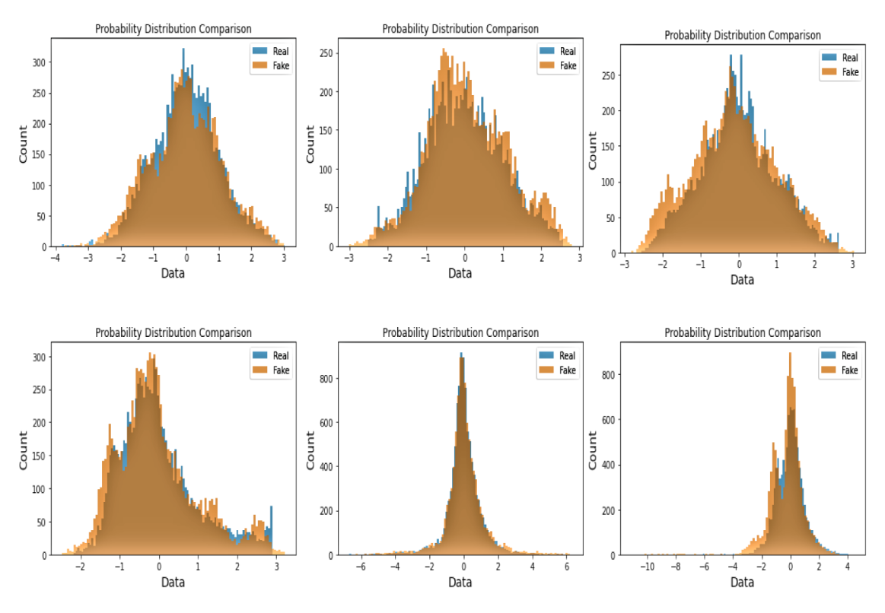
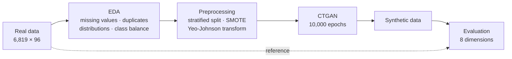
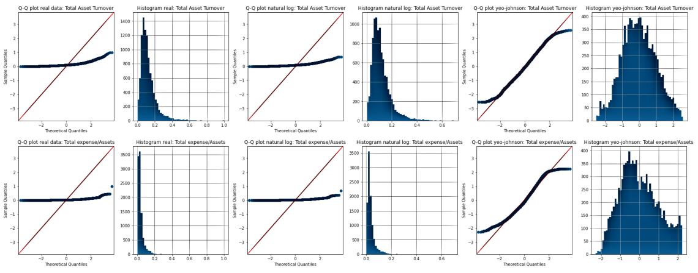
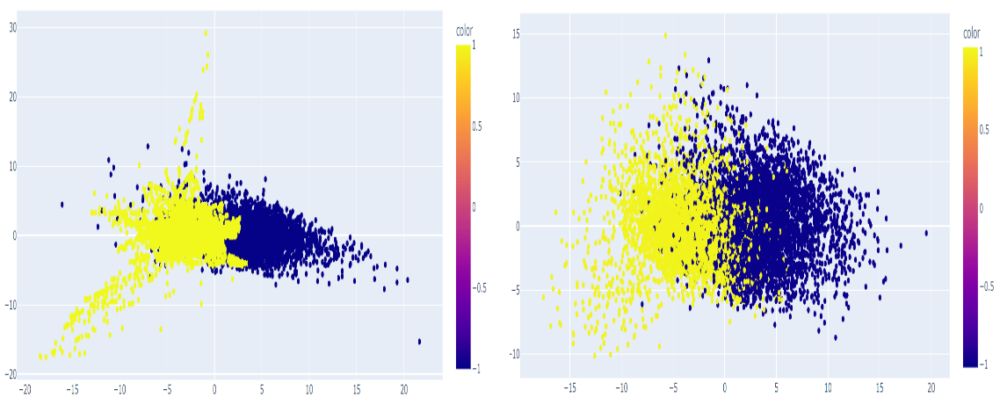
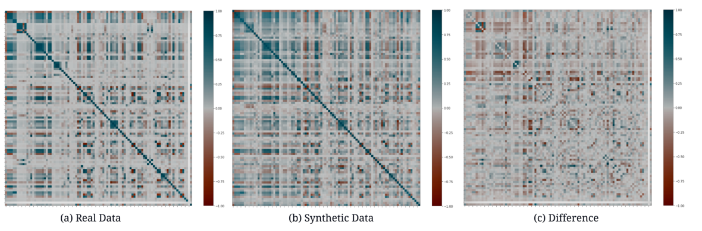

<div align="center">

# GAN-based Synthetic Tabular Data Generation

**Preparing real data for CTGAN, and a multi-dimensional framework for checking synthetic data quality**

B.Sc. thesis · Department of Computer Science & Engineering<br>
Rajshahi University of Engineering & Technology (RUET), Bangladesh · November 2022

**Md. Aukerul Moin Shuvo** · **[Md. Shohanoor Rahman](https://srahman7900.github.io/)**<br>
Supervisor: **Barshon Sen**, Assistant Professor, CSE, RUET

[](https://srahman7900.github.io/)
[](mailto:srahman7900@gmail.com)
[](https://orcid.org/0009-0004-4447-7502)
[](https://www.linkedin.com/in/shohanoor-rahman/)

[](docs/BSc_thesis_RUET_2022.pdf)
[](docs/seminar_slides_2022-08.pdf)
[](https://colab.research.google.com/github/srahman7900/UG-Thesis/blob/main/notebooks/eda_preprocessing_ctgan.ipynb)


[](LICENSE)

</div>

---

## Overview

Real data is often scarce, expensive to collect, or too sensitive to share. Synthetic data can stand in
for it, but only if it keeps the statistical structure that makes the real data useful. Most research on
generative adversarial networks (GANs) for tables proposes new architectures. Much less of it asks two
practical questions:

1. **Before training:** how should real tabular data be prepared so a GAN can learn it well?
2. **After training:** how do we show, from several independent angles, that the synthetic data is
   trustworthy?

This thesis works through both questions on a hard, realistic case: **6,819 Taiwanese companies described
by 95 financial ratios**. Most of the features are heavily skewed, and only **3.2% of the companies went
bankrupt**. We build an EDA-driven preprocessing pipeline, train a tuned **Conditional Tabular GAN
(CTGAN)**, and evaluate the synthetic output in **eight dimensions**, from marginal distributions to
downstream machine-learning performance.

<div align="center">

<br><sub><b>Real (blue) vs. synthetic (orange)</b> distributions for six transformed features. CTGAN reproduces skewed, heavy-tailed and multi-peaked shapes.</sub>
</div>

### Results at a glance

| Check | Real data | Synthetic data |
|---|:---:|:---:|
| Variance captured by the first 2 / 3 principal components | 37.09% / 48.74% | 36.76% / 47.12% |
| XGBoost accuracy (best model on both) | 0.982 | 0.963 |
| Random-forest accuracy | 0.961 | 0.955 |
| Top-10 features by χ² that also appear in the other set | — | 8 of 10 |
| Features kept by variance-threshold selection | 24 | 23 (all 23 also in the real set) |

Detection metrics give 1.0 when the two tables cannot be told apart: **logistic detection 0.98**,
**SVC detection 0.99**, **KS test 0.86**, **extended KS test 0.88**.

---

## Contributions

1. **A data-preparation pipeline for GAN training.** EDA findings drive each preprocessing step. Heavy
   skew is corrected with a Yeo-Johnson power transform, chosen over the log transform by comparing Q-Q
   plots for all 96 columns. The 3% minority class is rebalanced with SMOTE on the training split only.
2. **A tuned CTGAN configuration** for wide, continuous, imbalanced financial data.
3. **An eight-dimension evaluation protocol** for synthetic tabular data. It combines descriptive,
   geometric, statistical, feature-importance, information-theoretic and downstream-task checks
   against the real data.

**Author contributions.** This was a two-person thesis. Md. Shohanoor Rahman was responsible for the
literature review, the exploratory data analysis and the results analysis (statistical tests, PCA,
mutual information, and the train-on-synthetic, test-on-real evaluation).

## Pipeline



---

## 1. Dataset

[Taiwanese Bankruptcy Prediction](https://archive.ics.uci.edu/dataset/572/taiwanese+bankruptcy+prediction)
(Liang et al., 2016), from the UCI Machine Learning Repository. The records come from the Taiwan
Economic Journal for 1999–2009. A company is labelled bankrupt according to the business rules of the
Taiwan Stock Exchange.

| Property | Value |
|---|---|
| Rows | 6,819 companies |
| Columns | 95 financial ratios + `Bankrupt?` label |
| Missing values / duplicate rows | none / none |
| Class balance | 6,599 survived (96.77%) · 220 bankrupt (3.23%) |
| Main difficulty | most features are heavily right-skewed with long tails and outliers |

## 2. Preprocessing

- **Class imbalance.** We use a stratified train/test split and apply SMOTE oversampling to the
  training split only, so the held-out real test set keeps the true 3.2% bankruptcy rate.
- **Skew.** We compare the natural-log and Yeo-Johnson transforms with Q-Q plots and histograms for
  every column. The log transform barely moves the long-tailed features. Yeo-Johnson brings them close
  to normal, so it is used to train CTGAN.

<div align="center">

<br><sub>Q-Q plots and histograms for <i>Total Asset Turnover</i> and <i>Total expense/Assets</i>, shown raw (left), after the log transform (middle) and after Yeo-Johnson (right).</sub>
</div>

## 3. Generative model: CTGAN

Chapter 3 of the thesis reviews TGAN, MedGAN, TableGAN and CTGAN. We chose
[CTGAN](https://arxiv.org/abs/1907.00503) (Xu et al., NeurIPS 2019) because it targets the exact
problems this dataset has:

- **Mode-specific normalization.** A variational Gaussian mixture represents each continuous column, so
  multimodal, non-Gaussian columns do not collapse onto a single mode.
- **Conditional generator with training-by-sampling.** The generator sees rare categories during
  training even when the data is imbalanced.
- **WGAN-GP loss with PacGAN** (10 samples per pack) to stabilise training and reduce mode collapse.

| Hyperparameter | Value |
|---|---|
| Epochs | 10,000 |
| Batch size | 500 |
| Embedding dimension | 128 |
| Generator / discriminator layers | (256, 256) / (256, 256) |
| Generator / discriminator learning rate | 5e-4 / 5e-4 (Adam) |

After training, we sample about as many synthetic rows as there are real ones.

---

## 4. Evaluation framework

No single score shows that a synthetic table is good. We therefore test it from eight angles, each
compared directly against the real data.

| # | Dimension | Question it answers | Method |
|:-:|---|---|---|
| 1 | EDA parity | Is the synthetic table clean and correctly balanced? | missing values, duplicate rows, class balance |
| 2 | Marginal distributions | Does each column have the right shape? | per-feature histograms |
| 3 | Global structure | Is the overall geometry preserved? | PCA in 2-D and 3-D, variance captured |
| 4 | Pairwise dependencies | Do features still move together? | 96×96 correlation matrices, their difference, top-3 correlations |
| 5 | Statistical tests | Can a test or a classifier tell the two tables apart? | KSComplement, CSTest, logistic detection, SVC detection |
| 6 | Feature importance | Do the same variables matter? | RFECV, χ² selection, variance threshold |
| 7 | Information content | Does each feature carry similar information? | mutual information per feature |
| 8 | ML efficacy | Can the synthetic data replace the real data for a model? | six classifiers trained on real vs. synthetic data |

## 5. Results

### Global structure (PCA)

<div align="center">

<br><sub>First two principal components, <b>real (left)</b> and <b>synthetic (right)</b>, coloured by class.</sub>
</div>

| Principal components | Real | Synthetic |
|---|:---:|:---:|
| First 2 | 37.09% | 36.76% |
| First 3 | 48.74% | 47.12% |

### Feature correlations

<div align="center">

<br><sub>Correlation matrices for all 96 features: (a) real, (b) synthetic, (c) difference. The difference matrix is mostly near zero.</sub>
</div>

### Statistical tests

| Metric | Score | Range | Goal |
|---|:---:|:---:|:---:|
| Logistic regression detection | 0.983 | 0–1 | maximize |
| SVC detection | 0.997 | 0–1 | maximize |
| Kolmogorov–Smirnov (KSComplement) | 0.864 | 0–1 | maximize |
| Kolmogorov–Smirnov, extended | 0.883 | 0–1 | maximize |

### Feature importance

- **RFECV:** 32 features are optimal on real data and 41 on synthetic data.
- **χ² selection:** 8 of the top 10 features are shared between the real and synthetic data.
- **Variance threshold:** 24 features pass on real data and 23 on synthetic data. All 23 synthetic
  features are also in the real set.
- **Mutual information:** per-feature mutual information follows the same pattern in both datasets
  (thesis Figures 6.9–6.10).

### Machine-learning efficacy

| Classifier | Trained on real | Trained on synthetic |
|---|:---:|:---:|
| **XGBoost** | **0.982** | **0.963** |
| Random forest | 0.961 | 0.955 |
| Decision tree | 0.952 | 0.913 |
| Gaussian naive Bayes | 0.594 | 0.591 |
| Logistic regression | 0.592 | 0.560 |
| SVM | 0.527 | 0.510 |

The classifiers keep the same ranking on both datasets, and the strongest models lose 0.6–3.9
percentage points of accuracy.

---

## Limitations and next steps

The thesis notes two limitations. CTGAN does not enforce relational constraints between columns, and
feature-importance scores differ in places (for example, RFECV picks 32 features on real data and 41 on
synthetic data).

Looking back, a stronger version of this study would:

- **Run ablations for the preprocessing claim.** Train CTGAN on raw, Yeo-Johnson-transformed, and
  SMOTE-balanced inputs and compare. CTGAN already applies its own mode-specific normalization, so how
  much an earlier power transform adds is an open question.
- **Avoid learning SMOTE's interpolations.** SMOTE builds the minority class from only about 165
  real bankrupt firms in the training split, so the GAN partly learns straight-line interpolations
  between them. CTGAN's own conditional sampling, or a GAN-based oversampler (listed as future work in
  the thesis), avoids this.
- **Report metrics suited to imbalance.** Report minority-class F1 and PR-AUC alongside accuracy in
  the train-on-synthetic, test-on-real evaluation, since accuracy alone says little when only 3.2% of
  firms go bankrupt.
- **Measure variance.** Repeat runs with fixed seeds and report mean ± standard deviation.
- **Add baselines and datasets.** Compare against a Gaussian copula, TVAE and SMOTE alone, on more
  than one dataset.
- **Measure privacy, not only fidelity.** Privacy motivates the work, so distance-to-closest-record
  and membership-inference tests belong in the evaluation.

---

## Repository structure

```
UG-Thesis/
├── data/
│   ├── company_bankruptcy.csv        # Taiwanese Bankruptcy Prediction data (UCI, CC BY 4.0)
│   └── download_data.py              # re-downloads the CSV and checks its shape and class counts
├── docs/
│   ├── BSc_thesis_RUET_2022.pdf      # full thesis (101 pages)
│   ├── seminar_slides_2022-08.pdf    # seminar presentation, August 2022
│   └── figures/                      # thesis figures used in this README
├── notebooks/
│   └── eda_preprocessing_ctgan.ipynb # EDA, preprocessing and CTGAN set-up
├── requirements.txt
├── CITATION.cff
└── LICENSE
```

> [!NOTE]
> **What the code covers.** The notebook is the original Google Colab notebook from August 2022,
> with its outputs. It contains the EDA, the preprocessing (split, SMOTE, log vs. Yeo-Johnson) and a
> 1-epoch CTGAN run that checks the pipeline end to end. The full model used the hyperparameters
> listed above. The Chapter 6 evaluation results come from the thesis; their code is not in this
> repository. Random seeds were not fixed in 2022, so re-runs give slightly different splits and plots.

## Getting started

The quickest option is the **Open in Colab** badge at the top. To run locally (`ctgan` 0.5.1 supports
Python 3.7–3.9):

```bash
git clone https://github.com/srahman7900/UG-Thesis.git
cd UG-Thesis
python3.9 -m venv .venv && source .venv/bin/activate

# Apple Silicon only: PyYAML 5.4.1 (required by ctgan 0.5.1) has no arm64 wheel
pip install "cython<3" wheel && pip install --no-build-isolation pyyaml==5.4.1

pip install -r requirements.txt jupyter
python data/download_data.py          # checks the bundled CSV, or downloads it if missing
jupyter notebook notebooks/eda_preprocessing_ctgan.ipynb
```

## Citation

```bibtex
@thesis{shuvo2022gan,
  title       = {Generative Adversarial Network based Synthetic Data Generation System},
  author      = {Shuvo, Md. Aukerul Moin and Rahman, Md. Shohanoor},
  type        = {B.Sc. thesis},
  institution = {Rajshahi University of Engineering \& Technology},
  address     = {Rajshahi, Bangladesh},
  year        = {2022},
  url         = {https://github.com/srahman7900/UG-Thesis}
}
```

## License

- **Code** (the notebook and `data/download_data.py`): [MIT License](LICENSE).
- **Dataset** (`data/company_bankruptcy.csv`): Taiwanese Bankruptcy Prediction by Deron Liang and
  Chih-Fong Tsai, redistributed from the
  [UCI Machine Learning Repository](https://archive.ics.uci.edu/dataset/572/taiwanese+bankruptcy+prediction)
  under [CC BY 4.0](https://creativecommons.org/licenses/by/4.0/).
- **Thesis and slides** (`docs/`): © 2022 the authors. They are shared here for reading and citation.
  Some figures in them are reproduced from the cited sources and remain under those sources' terms.

## Acknowledgements

We thank our supervisor, **Barshon Sen** (Assistant Professor, CSE, RUET), for his guidance at every
stage of this work, and the CSE faculty at RUET. The dataset was made available by Deron Liang and
Chih-Fong Tsai (National Central University, Taiwan) through the UCI Machine Learning Repository.

## Key references

- I. Goodfellow et al., "Generative Adversarial Nets," *NeurIPS*, 2014.
- L. Xu, M. Skoularidou, A. Cuesta-Infante, K. Veeramachaneni, "Modeling Tabular Data using Conditional GAN," *NeurIPS*, 2019.
- N. V. Chawla, K. W. Bowyer, L. O. Hall, W. P. Kegelmeyer, "SMOTE: Synthetic Minority Over-sampling Technique," *JAIR* 16, 2002.
- I.-K. Yeo, R. A. Johnson, "A New Family of Power Transformations to Improve Normality or Symmetry," *Biometrika* 87(4), 2000.
- D. Liang, C.-C. Lu, C.-F. Tsai, G.-A. Shih, "Financial Ratios and Corporate Governance Indicators in Bankruptcy Prediction: A Comprehensive Study," *European Journal of Operational Research* 252(2), 2016.

The full list of 95 references is in the [thesis](docs/BSc_thesis_RUET_2022.pdf).

## Contact

**Md. Shohanoor Rahman** · Dhaka, Bangladesh<br>
I am applying for PhD programs starting Fall 2027 and welcome questions about this work. Email is the
best way to reach me.

- Email: [srahman7900@gmail.com](mailto:srahman7900@gmail.com)
- Website and CV: [srahman7900.github.io](https://srahman7900.github.io/) · [CV](https://srahman7900.github.io/cv.html)
- ORCID: [0009-0004-4447-7502](https://orcid.org/0009-0004-4447-7502)
- LinkedIn: [shohanoor-rahman](https://www.linkedin.com/in/shohanoor-rahman/)
- GitHub: [srahman7900](https://github.com/srahman7900)

This thesis was my first work with generative models. My current research uses diffusion models to
audit melanoma classifiers: [melanoma-concept-audit](https://github.com/srahman7900/melanoma-concept-audit).
